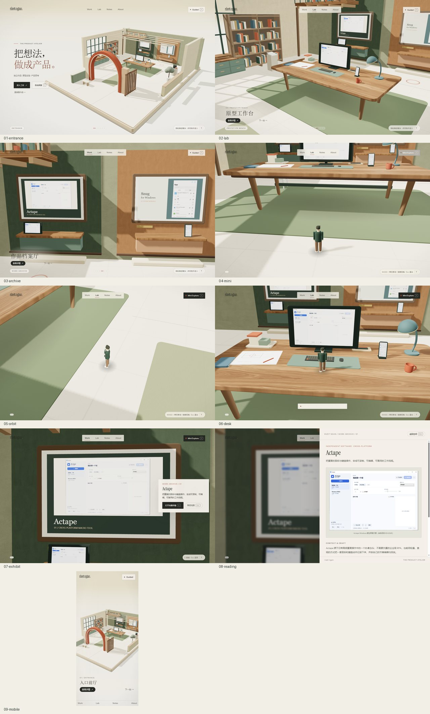

# E2 Illustrated Atelier — verified implementation checkpoint

Tested revision: `23d15d6bd016d742bf84b49a87bb2027685fcaf7`. Development branch; main remains unchanged.

## Implemented
Local CC0 plaster and walnut textures graded to E2, glTF chair via official Three.js r128 GLTFLoader, genuine side window and mullion shadows, decorative loft, storage and workbench details, actual Actape monitor image and distinct product display units. Reworked miniature body and apparel using existing articulated procedural rig. Explicit E near exhibits, same-chapter position and orbit resume, reduced default boom, revised help and collision footprints. See DESIGN_SYSTEM_E2.md for production standards and asset provenance.

## Actual QA
Windows Chrome, CDP, SwiftShader. Real keyboard/mouse input; chapter setup and reading close used inspection hooks.
- Syntax and git diff checks passed; WebGL and all six asset readiness flags true.
- Full headless test exit 0 (125.63s), zero Runtime.exceptionThrown. F enter, fallback drag and wheel, W approach and auto mount to y=1.02, S dismount to y=0, F exit/return within .08 units and same orbit yaw.
- Walking near Actape did not trigger lift; E initiated OBJECT_PREVIEW, E opened READING with loaded product image. S descended and restored orbit yaw.
- 390x844 mobile viewport rendered.
- Headed Chrome was visible and focused. Genuine native pointer capture succeeded (mouseCaptured=true, lockUnavailable=false); direct mouse movement changed yaw and pitch; Escape released capture while remaining in Mini. Headed test exit 0 (26.02s), zero Runtime.exceptionThrown.

## Evidence
[Entrance](docs/qa/e2-entrance.jpg) · [Workbench](docs/qa/e2-lab.jpg) · [Mini on desk](docs/qa/e2-mini-desk.jpg) · [Native mouse](docs/qa/e2-native-mini.jpg) · [Mobile](docs/qa/e2-mobile.jpg)

## Release gate
Full continuous 360 sweep, near-wall corners, native reacquisition, physical phone gestures and ordinary GPU performance remain pending. No frame-rate claim. Current art is materially improved but remains short of E2 concept's handcrafted architectural illustration and detailed character; only the chair is a sourced glTF model. No final Blender rigged character or complete authored model set. Keep main unchanged until the visual gate and remaining interaction tests pass.
