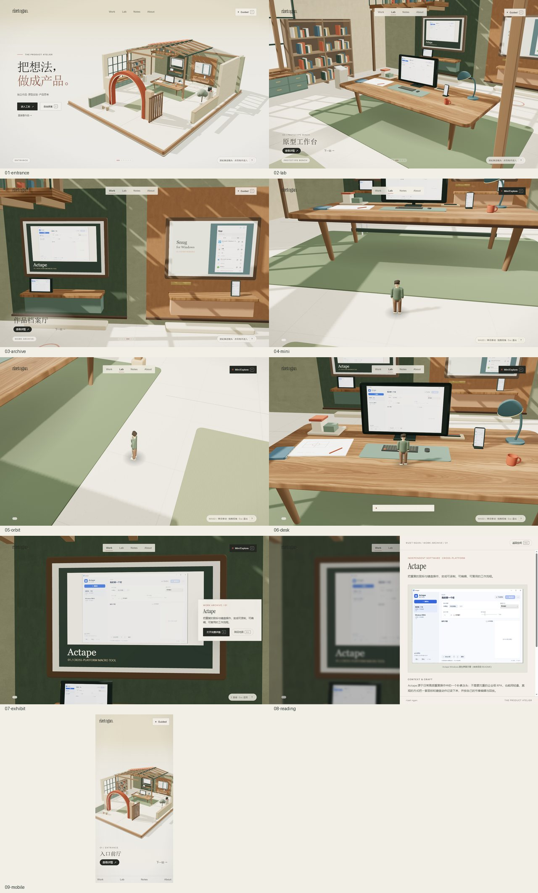

# E2.3 — Blender production pipeline and native camera validation

Tested revision: `422a537b7f58a742173d191b95ddd424c96d31f2`. Development branch; main remains unchanged.

## Authored assets
Blender Python 5.1.2 installed and successfully executed in an isolated Windows virtual environment. Original, reproducible source: [tools/build-e2-models.py](tools/build-e2-models.py). Two editable .blend files saved to the build output directory (not tracked; reproducible from source). Official Blender glTF exporter generated:
- [atelier-roof.glb](assets/e2/atelier-roof.glb), 191,692 bytes, git blob fec9e199e881d324fa4d616fbe8f2b28893ed875. Cutaway roof, clay rear strip, exposed rafters, ridge and columns.
- [mini-tailored.glb](assets/e2/mini-tailored.glb), 447,076 bytes, git blob eb903f86afa73ebf6cf4e53fbf41f2fb21ccb0df. One actual glTF skin with five named bones, original sculpted clothing, hair, features and shoes. Existing gameplay joint motion drives four limbs; no claim of motion-captured or full knee/elbow articulation. Browser fallback remains available.
Both GitHub blobs matched local hashes. Source uses no third-party model assets. Three.js r128 loader confirmed both assets ready. Deeper model base, shortened foreground, revised entrance framing, roof column collision.

## Actual browser QA
Windows Chrome with CDP / SwiftShader; both final runs completed successfully, no Runtime.exceptionThrown.
- Node syntax and git diff check passed; all eight asset readiness flags true.
- Full regression exit 0 (130.86 s): Guided scenes; F Mini mode, mouse fallback orbit, wheel zoom; W auto mount y=1.02 and S down to y=0; same-chapter resume; approach Actape without lift; E lift and E reading; descend restoring yaw; 390x844 mobile emulation.
- Headed native input exit 0 (80.41 s): genuine pointer lock, Windows relative mouse input only when isolated test Chrome owned foreground. Event-by-event yaw tracking: 21 events, 1,796 px, cumulative -6.286 radians (360.16 degrees), max angular response error ~2.22e-16 rad. Escape releases capture and click reacquires.
- Rear-wall approach reaches z=-4.55. Full 20-event second sweep: -6.286 rad, sampled minimum camera z=-5.15144, inside rear wall front face (~-5.325). No automatic lift. These are sampled camera states, not proof of every corner or swept-volume collision.
- Earlier periodic-angle sampling run was inconclusive (event coalescing); replaced by event-level measurement. No physical mobile touch or ordinary GPU frame pacing claim.

## Actual rendered evidence
[Entrance](docs/qa/e23-entrance.jpg) · [Workbench](docs/qa/e23-lab.jpg) · [Mini on floor](docs/qa/e23-mini.jpg) · [Mini on desk](docs/qa/e23-mini-desk.jpg) · [Mobile](docs/qa/e23-mobile.jpg)

## Art review
Real model pipeline and core native interaction now verified. Original E2 concept is a richer, hand-crafted cutaway building with a connected facade, detailed studio, layered surfaces and subtle light. Current actual render remains simplified and not final E2 art approval. Remaining work: further authored studio furniture and facade, lighting/texture finish, complete collision corner and mobile/ordinary GPU tests. Do not publish main prematurely.
