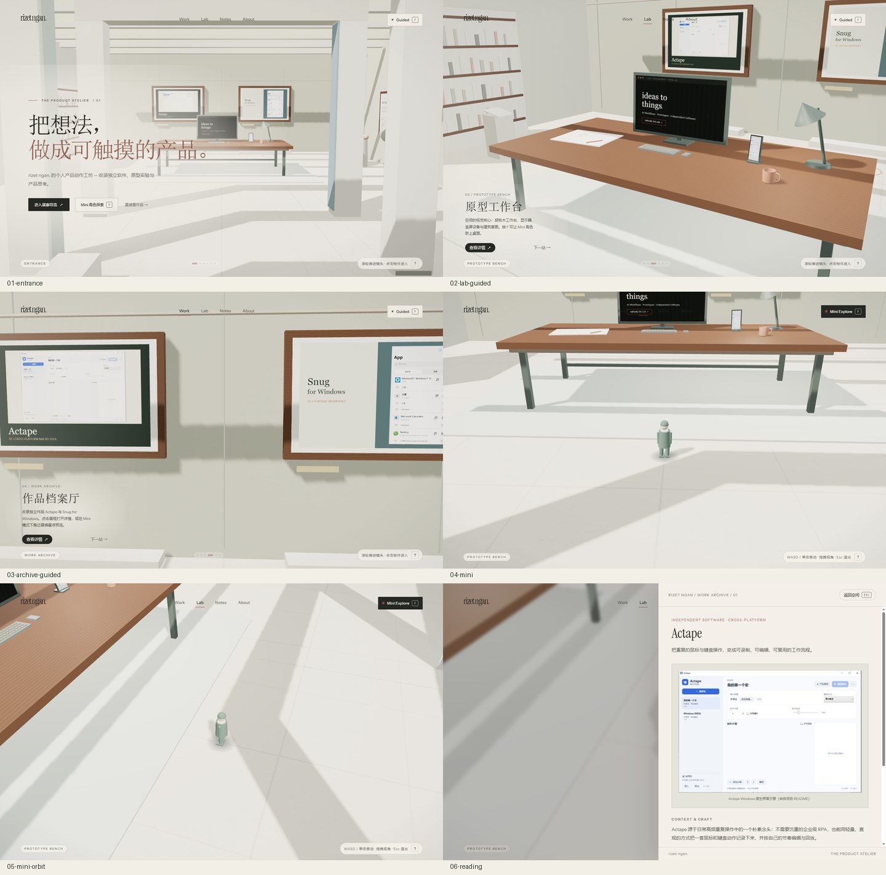

# V7 Editorial Maquette — development checkpoint

Tested revision: `20cf092142fa9ece7a4ab16c8d57802b67e9bf42`. This is a development branch, not a production release.

## Implemented
- Native pointer-lock mouse look on explicit desktop Mini entry; Escape releases, clicking canvas resumes; drag/click-to-walk remains fallback when unsupported or refused.
- Reading and help suspend movement; mouse capture is released on exit, focus loss, reading and exhibit framing.
- Camera damping and interpolation-segment collision check; slower character locomotion; reduced Mini HUD.
- Editorial sage/ink/clay/blue/ochre palette, selectively retained architectural sketch edges, lighting and prop refinements.
- Product imagery copied byte-for-byte from [Actape Windows README preview](https://github.com/rizetngan/Actape/blob/main/docs/windows-preview.png) and [Snug actual phone workspace](https://github.com/rizetngan/snug-for-windows/blob/main/Assets/WindowsMedia/phone-running.png). Actape is a published UI illustration, not an independently verified screen capture; Snug is documented as virtual-screen capture. Product images are loaded locally in exhibits and reading panels.
- Vendored Three.js r128 from upstream tag r128, with MIT LICENSE. No runtime CDN dependency for Three.js.

## Verified in Windows Chrome headless (CDP, SwiftShader)
- `node --check app.js`, `node --check atelier-scene.js`, and `git diff --check` passed.
- WebGL initialized with local Three.js.
- Guided entrance, lab and archive rendered.
- All 3 product textures loaded.
- Mini entered, right-drag fallback changed yaw and pitch, wheel changed boom distance, D moved character.
- Reading opened with image loaded; character position and orbit retained on return.
- 390x844 mobile viewport rendered Guided entrance (emulation, not physical phone test).
- Final browser test completed with exit code 0 and zero Runtime.exceptionThrown events.
- Pointer lock was refused/unavailable in headless Chrome; native pointer-lock behavior has **not** been verified in an interactive browser.
- Camera near-wall transitions, full 360 degree rotation, automatic desk mount/dismount, wall lift, actual mobile gestures and frame-rate on ordinary GPUs remain pending.

## Actual rendered evidence
[Desktop six-view contact sheet](docs/qa/v7-desktop-qa.jpg)

[Mobile emulated viewport](docs/qa/v7-mobile-qa.jpg)

## Art direction assessment and release gate
The screenshots show a cleaner material hierarchy and more authentic product content. They still read as a procedural gallery prototype rather than the intended European-comic architectural model: repetitive rectangular portal ribs, oversized empty floor, generic bookcase and desk silhouettes, hard shadows, and small character presentation. Do not merge to main as the final art version. The next art pass should establish a distinctive asymmetrical spatial composition, authored hero props and architectural textures, then verify the three signature camera frames before expanding the remaining zones. Full immersive interaction and visual quality must be checked before release.
