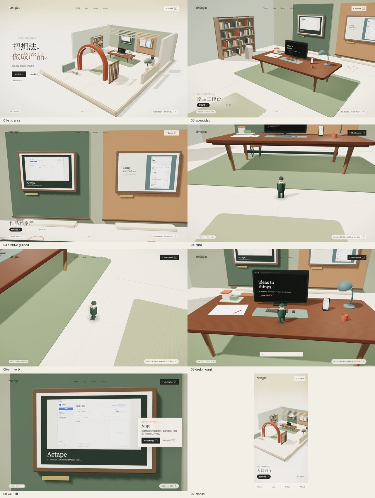

# V7.2 — Sculpted Atelier

Tested revision: `1944d9d2df41383ced2ec8053d71ae8d20fa8749`. Development checkpoint; main remains unchanged.

## Art pass
- Rebuilt the repeated rectangular portals as a continuous extruded terracotta arch, offset cutaway wing walls, timber screen and open canopy.
- Reduced and rounded the model plinth; opened the viewing-side wall; extended the presentation ground to remove the visible horizon.
- Original rounded timber trestle desk, bent-plywood chair, enamel task lamp, linen rugs, architectural study model, open joinery bookcase and product frames.
- Normalized authored sRGB material colors to Three.js r128 linear space, with selective architectural ink contours and retained original product imagery.
- Revised guided entrance, corridor, lab, work and portrait entrance camera framing; simplified entrance copy and redundant guidance.
- Preserved existing interaction anchors and adjusted collision footprints for the arch, screen, wing, chair and study model. Mini default boom 3.15.

## QA
Windows Chrome headless, CDP, SwiftShader; actual local WebGL, not concept art.
- JavaScript syntax and git diff checks passed.
- Full smoke suite exit 0; Runtime.exceptionThrown events 0. Guided entrance/lab/archive, 3 product textures, Mini entry, right-drag orbit, wheel zoom, keyboard movement, reading image and state return, 390x844 viewport.
- Separate traversal suite exit 0, Runtime.exceptionThrown events 0. QA hook initiated mount, completed at desk y=1.02; S-key movement triggered dismount to floor. QA hook initiated Actape wall lift; preview, open detail, close detail, descend and restore orbit all passed.
- Direct QA hooks verify traversal state transitions, not the entire approach/intent detection path. Camera collision edge cases, 360-degree rotation, desktop native pointer-lock and physical mobile gestures remain pending. Native pointer lock was refused/unavailable in headless Chrome; fallback worked.
- No production performance claim. No asset-library dependencies introduced; geometry and textures authored in code.

## Evidence
[Entrance full-size](docs/qa/v72-entrance.jpg) · [Eight actual views](docs/qa/v72-desktop-qa.jpg) · [Mobile emulation](docs/qa/v72-mobile-qa.jpg)

## Review
The model silhouette, asymmetric layout, palette, furniture and entrance framing are materially improved over V7.1. The visual remains simplified rather than a fully hand-illustrated European comic scene. Further work: stronger material microdetail, finer miniature character silhouette, intentional environmental storytelling, and native desktop control verification. Do not merge to main until visual direction and native Mini interaction are accepted.
